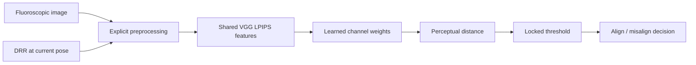

# FluoroQA

**Learned perceptual metrics for fluoroscopic 2D/3D registration quality assessment.**

FluoroQA compares a fluoroscopic image with a rendered image at a candidate pose.
It adapts the VGG-based [LPIPS metric](https://github.com/richzhang/PerceptualSimilarity)
using pose-supervised triplet learning, an optional mTRE-dependent margin, and an
optional binary classification loss on the distance itself. It is not a new VGG
architecture and does not claim to replace LPIPS attribution.

**Initial research-code release.** This repository contains the metric, losses,
preprocessing helpers, current-pose neighborhood geometry, threshold evaluation,
a provider-based training entry point, three recipes and offline synthetic tests.
It does **not** include medical data, trained FluoroQA weights, a DRR renderer,
the private data adapter, or a turnkey reproduction of the paper's experiments.
No clinical use or diagnostic performance is certified.

## Method



Larger distance means greater dissimilarity. The training objective is
`mean(relu(d_positive - d_negative + margin))`, with either zero margin or
`margin = 0.001 * min(actual_mTRE_mm, 10)`.

The BCE variant adds `weight * BCEWithLogits((distance-offset)/scale, failure)`.
GT-image pairs have label 0; perturbed pairs have label 1 when mTRE is at least
2 mm. There is no extra trainable classifier. These scores are **not calibrated
probabilities**. Ranking GT below a perturbation is not classification accuracy,
and low distance does not guarantee low pose error or a good optimization basin.

| Recipe | VGG | Trainable components | Epoch interval |
|---|---|---|---|
| `configs/zero.json` | Frozen | 1,472 channel coefficients | 0 → 200 |
| `configs/mtre.json` | Frozen | 1,472 channel coefficients | 0 → 200 |
| `configs/mtre_bce.json` | Last 4 of 13 convolutions unfrozen | Tail + channel coefficients | 200 → 350 |

The BCE recipe starts from the mTRE **last epoch-200** checkpoint, not its best
validation checkpoint. Its fixed constants are the historical **256-pixel**
training-only probe values. Do not assume they transfer to a new model, dataset
or resolution. See [protocol details](docs/protocol.md).

## Install and offline test

Python 3.10 or newer; Python 3.11 was used for release checks. Install a compatible
PyTorch/torchvision pair for your CPU or CUDA environment first.

```bash
python -m pip install -e .
python -m unittest discover -s tests -v
fluoroqa-train --config configs/smoke.json --provider fluoroqa.synthetic:build --output runs/smoke --device cpu --offline-smoke
```

The smoke command uses random weights and artificial images. It tests plumbing,
not medical performance. It does not download weights. Normal model construction
uses upstream LPIPS and torchvision pretrained weights and can download VGG
weights if they are not cached. Those assets retain their upstream terms.

## Train with your authorized data and renderer

Implement the [data-provider contract](docs/data.md) in an importable module. It
must generate one fresh negative per train frame per epoch and a fixed validation
bank. Keep CT, fluoroscopy, geometry and split information private.

```bash
fluoroqa-train --config configs/mtre.json --provider my_data:build --output runs/mtre --device cuda
fluoroqa-train --config configs/mtre_bce.json --provider my_data:build --init-checkpoint runs/mtre/epoch_200.pt --output runs/mtre_bce --device cuda
tensorboard --logdir runs
```

The entry point refuses to overwrite an output directory. Every epoch saves
model weights, named Adam state, Torch RNG state, configuration, metrics and
validation scores. Training and validation scalars are separate in TensorBoard.
All generated files are **private by default**; do not commit `runs/`.
Checkpoints are full models and can be large, especially after unfreezing. Plan
disk space before long runs. There is no automatic remote launcher or recovery.

The portable runner uses last-epoch checkpoints. It does not replicate the
historical multi-best selection/archival orchestration. Dataset RNG must be
stateless and keyed as specified in the provider contract. Legacy private
checkpoints are not automatically accepted or converted.

## Score an image pair

```python
import torch
from fluoroqa.model import FluoroQA
from fluoroqa.engine import load_checkpoint

model = FluoroQA(pretrained=False)  # avoid download before loading your model
load_checkpoint("runs/mtre/epoch_200.pt", model)
model.eval()
# fixed and moving: aligned polarity, float32 [0,1], shape [N,1,H,W].
with torch.no_grad():
    distance = model(fixed, moving)
```

`fixed` and `moving` above are tensors supplied by your application; loading a
checkpoint does not preprocess images. Read [the image contract](docs/data.md).

## Classify without GT at inference

```python
from fluoroqa.calibration import fit_threshold, evaluate

threshold = fit_threshold(train_scores, train_mtre_mm, split="train", mode="raw")
# Lock the threshold before looking at evaluation labels.
predicted_failure = test_scores >= threshold
report = evaluate(test_scores, test_mtre_mm, threshold)  # offline evaluation only
```

- **Raw:** one fixed image/DRR pair; threshold selected on train only.
- **Local:** render 12 neighbors around the **current** pose using
  `geometry.current_neighbors`. Subtract their mean, optionally divide by their
  population standard deviation. Threshold selected on val under the historical
  local protocol. No GT pose is used to center the neighbors.
- GT labels are needed for supervised training, threshold fitting, and offline
  evaluation, but not for deployment scoring. Calling data “train” is not proof
  of split isolation; the application must enforce and record identities.

`evaluate` returns accuracy, failure recall, success specificity, balanced
accuracy and pooled AUROC. Single-class AUROC is undefined (`None`). Pooled
AUROC is distinct from within-background ranking. Do not mix those evaluations.

## Scope, privacy and attribution

The release includes no patient examples, numerical benchmark claims, model
weights, private renderer code, server scripts, credentials or original Git
history. See [third-party notices](THIRD_PARTY_NOTICES.md),
[privacy checklist](docs/privacy.md) and [release review](docs/release_review.md).
Code: MIT. Data, dependency source and pretrained weights have separate terms.

Please cite the underlying LPIPS work when using this implementation:

> Richard Zhang, Phillip Isola, Alexei A. Efros, Eli Shechtman, Oliver Wang.
> *The Unreasonable Effectiveness of Deep Features as a Perceptual Metric.*
> CVPR 2018. [Paper](https://arxiv.org/abs/1801.03924).

FluoroQA manuscript citation and public trained weights are not yet provided.
