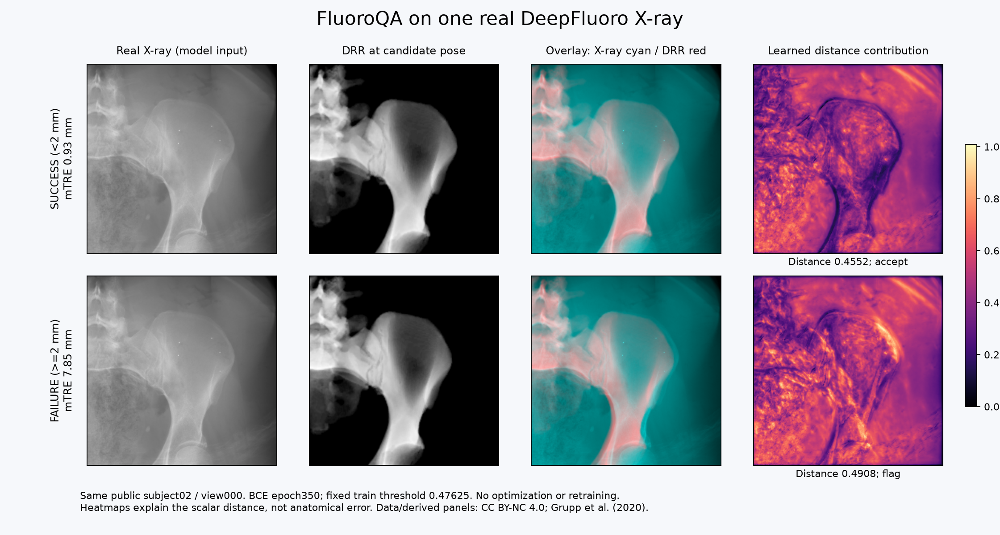
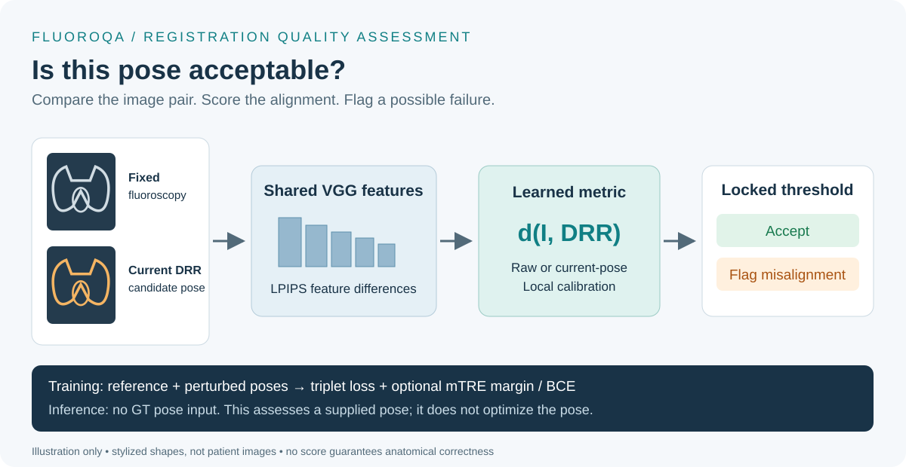
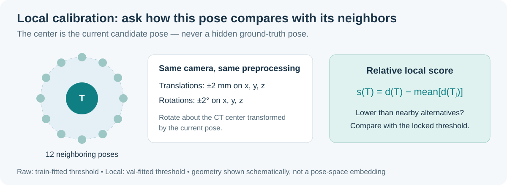
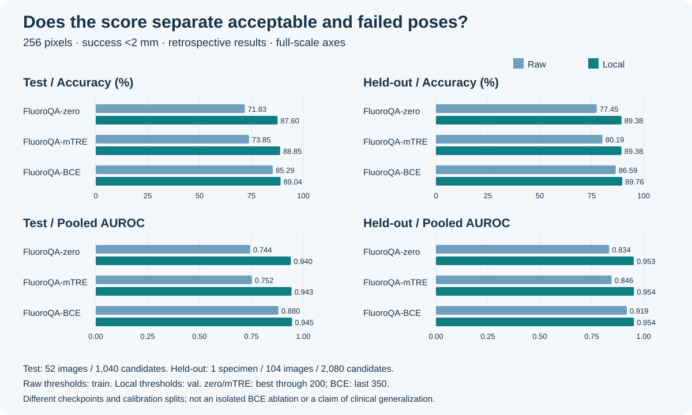

# FluoroQA

**Learned perceptual metrics for fluoroscopic 2D/3D registration quality assessment.**

[](LICENSE)


Research code for our ISBI 2027 submission
*FluoroQA: Learned Perceptual Metrics for Fluoroscopic 2D/3D Registration Quality Assessment*.

> **Code release.** This repository contains the model, losses, Local calibration,
> threshold fitting, evaluation metrics and training entry point. The trained
> weights, the DeepFluoro data pipeline and the evaluation scripts will be
> released upon acceptance.

[Interactive 2D–3D Projection Lab](https://jinhaolab.com/tools/2d3dreg/) ·
[Method](#method) · [Results](#results) · [Install](#install-and-test)



One public DeepFluoro view at two candidate poses: **0.93 mm mTRE (accepted)** and
**7.85 mm mTRE (flagged)** by FluoroQA-BCE with its train-selected threshold.
Cyan: X-ray; red: DRR. The maps show the learned distance contribution per pixel.
Image: Grupp et al. (2020), DeepFluoro, CC BY-NC 4.0 ([details](assets/deepfluoro/README.md)).

## Method

FluoroQA compares a fluoroscopic image with a DRR rendered at a candidate pose and
returns a dissimilarity score. It adapts the VGG-based
[LPIPS](https://github.com/richzhang/PerceptualSimilarity) metric with
pose-supervised triplet learning:

- **Triplet loss:** `mean(relu(d_positive - d_negative + margin))`, with
  `margin = 0` (zero) or `margin = 0.001 * min(mTRE_mm, 10)` (mTRE).
- **BCE variant:** adds `weight * BCEWithLogits((d - offset) / scale, failure)`,
  where failure means mTRE ≥ 2 mm. No extra classifier is trained.
- **Local calibration:** subtracts the mean score of 12 neighbouring poses around
  the *current* pose (±2 mm / ±2° along each camera axis). No ground-truth pose is
  needed at inference.



### Training protocol per variant

| Variant | Config | Trainable parameters | Epochs | Checkpoint used for reported results |
|---|---|---|---|---|
| FluoroQA-zero | `configs/zero.json` | 1,472 LPIPS channel weights; VGG frozen | 0 → 200 | Best validation ranking within 200 epochs |
| FluoroQA-mTRE | `configs/mtre.json` | 1,472 LPIPS channel weights; VGG frozen | 0 → 200 | Best validation ranking within 200 epochs |
| FluoroQA-BCE | `configs/mtre_bce.json` | Channel weights + last 4 VGG convolutions (conv4_3, conv5_1–3) | 200 → 350, from the mTRE epoch-200 model | Epoch 350 (fixed in advance) |

The paper summarises these settings in Sec. 2–3; this table gives the exact
per-variant protocol. All variants use Adam, batch size 4, LPIPS dropout 0.5 and
seed 923. Full details, including how the BCE constants were obtained from
training data only, are in [docs/protocol.md](docs/protocol.md).



## Results

DeepFluoro, 256 × 256 pixels, success = mTRE < 2 mm. Accuracy (%) and pooled
AUROC, reported as Raw / Local. Raw thresholds are selected on training data,
Local thresholds on validation data (paper, Table 2B).

| Method | Test accuracy | Test AUROC | Excluded-specimen accuracy | Excluded-specimen AUROC |
|---|---|---|---|---|
| Gradient correlation (GC) | 86.8 / 88.6 | .943 / .952 | 86.4 / 86.8 | .926 / .932 |
| FluoroQA-zero | 71.8 / 87.6 | .744 / .940 | 77.5 / 89.4 | .834 / .953 |
| FluoroQA-mTRE | 73.8 / 88.8 | .752 / .943 | 80.2 / 89.4 | .846 / .954 |
| FluoroQA-BCE | 85.3 / **89.0** | .880 / .945 | 86.6 / **89.8** | .919 / .954 |

Test: 52 images (1,040 candidates) from the five training specimens.
Excluded specimen: 18-1109, 104 images (2,080 candidates), not used for training
or validation. Each image has 20 candidates (60% acceptable, 40% failed).
The exact aggregates are in [assets/results.json](assets/results.json); the chart
below is generated by `python scripts/build_results_figure.py`
([provenance](docs/visualizations.md)).



## Install and test

Python 3.10 or newer. Install a PyTorch/torchvision pair for your CPU or CUDA
environment first, then:

```bash
python -m pip install -e .
python -m unittest discover -s tests -v
fluoroqa-train --config configs/smoke.json --provider fluoroqa.synthetic:build --output runs/smoke --device cpu --offline-smoke
```

The smoke run uses random weights and synthetic images; it checks the training
pipeline end to end without downloads. Tested versions are listed in
[requirements-tested.txt](requirements-tested.txt). Normal model construction
downloads the upstream LPIPS/VGG weights if they are not cached.

## Train on your data

Implement the [data-provider contract](docs/data.md) (one fresh negative per
training frame per epoch, a fixed validation bank), then:

```bash
fluoroqa-train --config configs/mtre.json --provider my_data:build --output runs/mtre --device cuda
fluoroqa-train --config configs/mtre_bce.json --provider my_data:build --init-checkpoint runs/mtre/epoch_200.pt --output runs/mtre_bce --device cuda
tensorboard --logdir runs
```

Each epoch saves model weights, optimizer and RNG state, configuration, and
separate training/validation metrics. The runner never overwrites an output
directory.

## Score and classify

```python
import torch
from fluoroqa.model import FluoroQA
from fluoroqa.engine import load_checkpoint
from fluoroqa.calibration import fit_threshold, evaluate

model = FluoroQA(pretrained=False)
load_checkpoint("runs/mtre/epoch_200.pt", model)
model.eval()
# fixed, moving: float32 in [0, 1], shape [N, 1, H, W], same polarity (see docs/data.md)
with torch.no_grad():
    distance = model(fixed, moving)

threshold = fit_threshold(train_scores, train_mtre_mm, split="train", mode="raw")
report = evaluate(test_scores, test_mtre_mm, threshold)  # accuracy, sensitivity, specificity, AUROC
```

For Local calibration, render the 12 neighbours with `fluoroqa.geometry.current_neighbors`
and score with `fluoroqa.calibration.local_score`. Ground-truth labels are needed
for training and threshold fitting, not for scoring at deployment.

## Data

DeepFluoro is public ([DOI 10.7281/T1/IFSXNV](https://doi.org/10.7281/T1/IFSXNV));
this repository does not redistribute it. The paper's DRRs use exponential ray
marching with the stored DeepFluoro camera geometry; the image contract a renderer
must meet is described in [docs/data.md](docs/data.md).

## Scope and limitations

- Results are retrospective. Test images come from the training specimens, and
  only one specimen is fully excluded; specimen-level replication is still needed.
- Pose errors are synthetic perturbations with a fixed 60/40 success/failure mix,
  not clinical prevalence.
- Scores are not calibrated probabilities; a low score does not guarantee a low
  pose error.
- Research software, not a medical device.

## License and citation

Code: MIT ([LICENSE](LICENSE)). The DeepFluoro example images are CC BY-NC 4.0.
Dependencies, datasets and pretrained weights keep their own terms
([third-party notices](THIRD_PARTY_NOTICES.md), [privacy notes](docs/privacy.md)).

A citation for FluoroQA will be added after the review process. Please also cite LPIPS:

> Richard Zhang, Phillip Isola, Alexei A. Efros, Eli Shechtman, Oliver Wang.
> *The Unreasonable Effectiveness of Deep Features as a Perceptual Metric.*
> CVPR 2018. [Paper](https://arxiv.org/abs/1801.03924).
