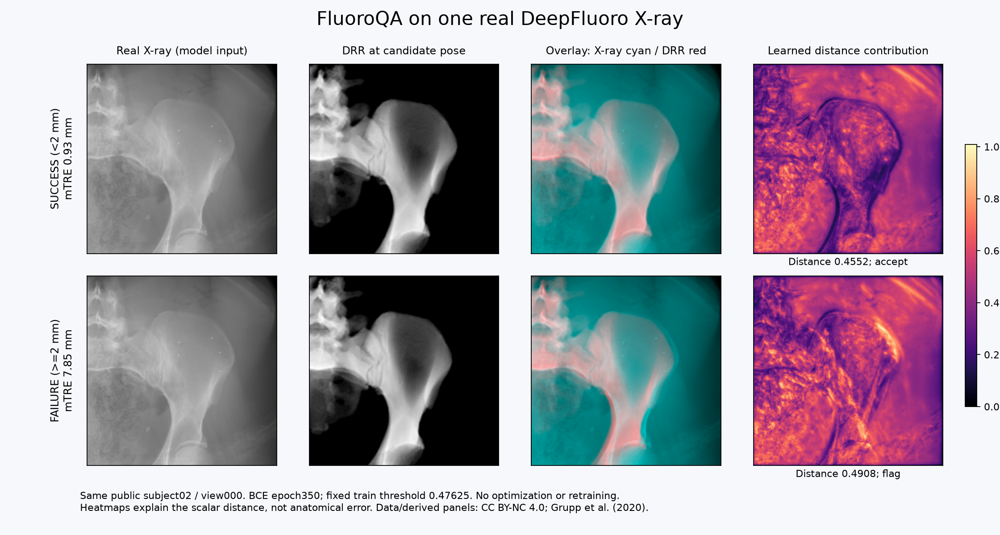
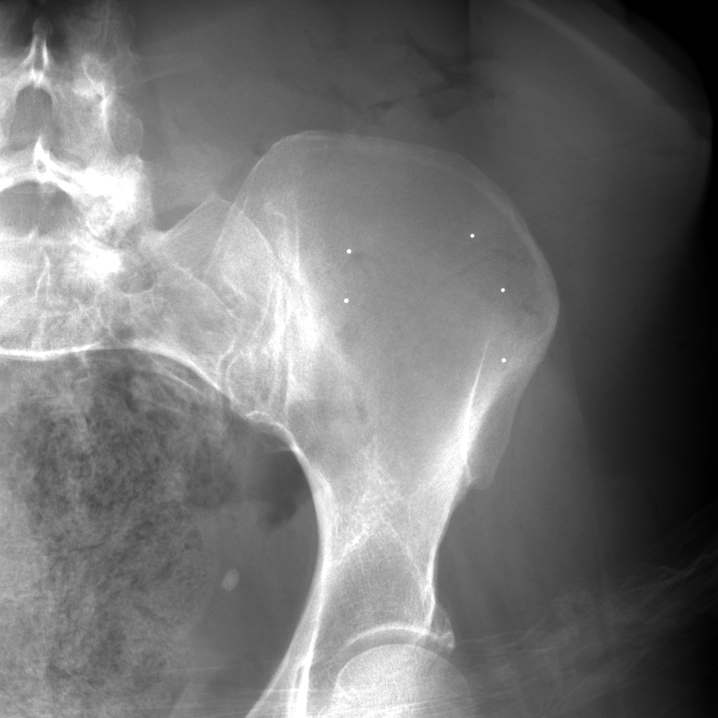
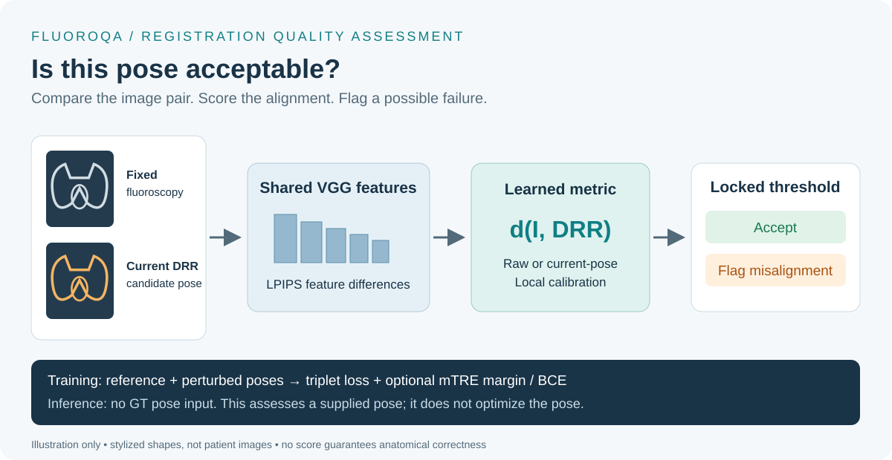
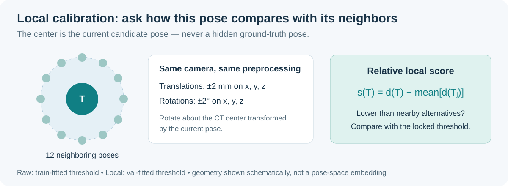
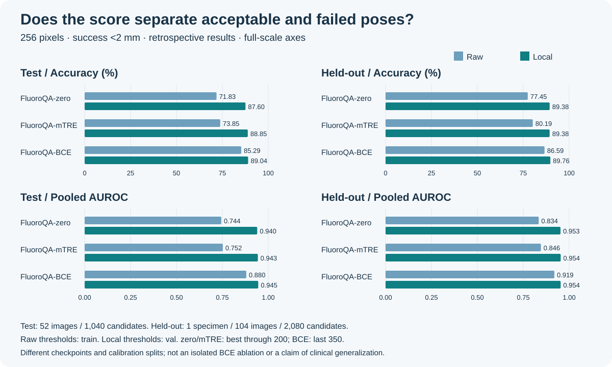

# FluoroQA

**Learned perceptual metrics for fluoroscopic 2D/3D registration quality assessment.**

[**Try the interactive 2D–3D Projection Lab →**](https://jinhaolab.com/tools/2d3dreg/)
 · [How it works](#method) · [Results at a glance](#results-at-a-glance) · [Install](#install-and-offline-test)



**Real example, not a schematic.** The same public DeepFluoro view is shown at
two candidate poses: **0.93 mm mTRE (success)** and **7.85 mm (failure)**.
FluoroQA-BCE accepts the first and flags the second using its previously locked
train threshold. Cyan is X-ray; red is DRR. Heatmaps show actual learned distance
contributions on a shared scale, not anatomical error labels or Grad-CAM.
These are existing perturbed poses, not before/after automatic optimization.
This selected illustration is not a new performance benchmark.
Image source: Grupp et al. (2020), DeepFluoro, **CC BY-NC 4.0**, separate from MIT code.
[Source, changes and verification](assets/deepfluoro/README.md).

FluoroQA compares a fluoroscopic image with a rendered image at a candidate pose.
It adapts the VGG-based [LPIPS metric](https://github.com/richzhang/PerceptualSimilarity)
using pose-supervised triplet learning, an optional mTRE-dependent margin, and an
optional binary classification loss on the distance itself. It is not a new VGG
architecture and does not claim to replace LPIPS attribution.

**Initial research-code release.** This repository contains the metric, losses,
preprocessing helpers, current-pose neighborhood geometry, threshold evaluation,
a provider-based training entry point, three recipes and offline synthetic tests.
Apart from the explicitly licensed public example figures, it does **not** include
medical datasets, trained FluoroQA weights, a DRR renderer,
the private data adapter, or a turnkey reproduction of the paper's experiments.
No clinical use or diagnostic performance is certified.

## Explore registration in your browser

The companion [**2D–3D Projection Lab**](https://jinhaolab.com/tools/2d3dreg/)
lets you explore how pose changes affect a CT-derived DRR and its overlay on a
fluoroscopic image. Open an example, drag to translate, right-drag to rotate,
and use the wheel to adjust depth. Switch between DRR, background and overlay;
reset the pose to compare again. The site also exposes camera and display controls.

This is a **manual projection/registration playground**, not an online FluoroQA
classifier or an automatic registration service. Its display preprocessing is
not the benchmark preprocessing contract. The site documents example data and
its CC BY-NC 4.0 terms separately. The public example below and the derived
panels above retain those terms; they are not MIT-licensed images.
No dataset upload is needed to try the supplied examples.



The website's public X-ray uses a negative-log display window. The model panels
use the historical 256-pixel benchmark preprocessing, not the website's display
pixels. They depict the same acquisition; contrast differs deliberately.

## Method



The overview separates the input pair, feature comparison and final
decision. Its shapes are schematic, not patient images or a measured alignment.

Larger distance means greater dissimilarity. The training objective is
`mean(relu(d_positive - d_negative + margin))`, with either zero margin or
`margin = 0.001 * min(actual_mTRE_mm, 10)`.

The BCE variant adds `weight * BCEWithLogits((distance-offset)/scale, failure)`.
GT-image pairs have label 0; perturbed pairs have label 1 when mTRE is at least
2 mm. There is no extra trainable classifier. These scores are **not calibrated
probabilities**. Ranking GT below a perturbation is not classification accuracy,
and low distance does not guarantee low pose error or a good optimization basin.

| Recipe | VGG | Trainable components | Epoch interval |
|---|---|---|---|
| `configs/zero.json` | Frozen | 1,472 channel coefficients | 0 → 200 |
| `configs/mtre.json` | Frozen | 1,472 channel coefficients | 0 → 200 |
| `configs/mtre_bce.json` | Last 4 of 13 convolutions unfrozen | Tail + channel coefficients | 200 → 350 |

The BCE recipe starts from the mTRE **last epoch-200** checkpoint, not its best
validation checkpoint. Its fixed constants are the historical **256-pixel**
training-only probe values. Do not assume they transfer to a new model, dataset
or resolution. See [protocol details](docs/protocol.md).

### Why use current-pose neighbors?



Local calibration asks whether a candidate scores better than nearby alternatives
for the **same image**. It does not need a GT pose at inference. The neighborhood
is defined geometrically by the current pose and camera, not by known pose error.
See the [geometry and preprocessing contract](docs/data.md) before using it.

## Results at a glance



This chart uses already-reviewed aggregate results, not synthetic demo scores.
At 256 pixels, FluoroQA-BCE achieved **89.04% Local accuracy on Test** and
**89.76% on one held-out specimen**. Local AUROC is similar across the three
variants; the chart does not imply uniform improvements or superiority to
traditional metrics, which are not plotted here.

Important context:

- Success is mTRE <2 mm; failure is ≥2 mm. Each image has 20 candidates,
  with 60% acceptable and 40% failed. This is not clinical prevalence.
- Raw thresholds use train; Local thresholds use val. Their difference is not
  a clean causal estimate of the effect of centering alone.
- zero/mTRE use best-validation-ranking checkpoints through epoch 200;
  BCE uses last epoch 350. These three bars are not a matched BCE-only ablation.
- Test shares specimens with training and has been explored repeatedly.
  The excluded cohort contains only one specimen. No patient-level uncertainty
  interval or prospective clinical generalization is established by this chart.

[Exact public aggregates](assets/results.json) ·
[Figure provenance and limits](docs/visualizations.md).
Regenerate the chart with `python scripts/build_results_figure.py`.

## Install and offline test

Python 3.10 or newer; Python 3.11 was used for release checks. Install a compatible
PyTorch/torchvision pair for your CPU or CUDA environment first.

```bash
python -m pip install -e .
python -m unittest discover -s tests -v
fluoroqa-train --config configs/smoke.json --provider fluoroqa.synthetic:build --output runs/smoke --device cpu --offline-smoke
```

The smoke command uses random weights and artificial images. It tests plumbing,
not medical performance. It does not download weights. Normal model construction
uses upstream LPIPS and torchvision pretrained weights and can download VGG
weights if they are not cached. Those assets retain their upstream terms.

## Train with your authorized data and renderer

Implement the [data-provider contract](docs/data.md) in an importable module. It
must generate one fresh negative per train frame per epoch and a fixed validation
bank. Keep CT, fluoroscopy, geometry and split information private.

```bash
fluoroqa-train --config configs/mtre.json --provider my_data:build --output runs/mtre --device cuda
fluoroqa-train --config configs/mtre_bce.json --provider my_data:build --init-checkpoint runs/mtre/epoch_200.pt --output runs/mtre_bce --device cuda
tensorboard --logdir runs
```

The entry point refuses to overwrite an output directory. Every epoch saves
model weights, named Adam state, Torch RNG state, configuration, metrics and
validation scores. Training and validation scalars are separate in TensorBoard.
All generated files are **private by default**; do not commit `runs/`.
Checkpoints are full models and can be large, especially after unfreezing. Plan
disk space before long runs. There is no automatic remote launcher or recovery.

The portable runner uses last-epoch checkpoints. It does not replicate the
historical multi-best selection/archival orchestration. Dataset RNG must be
stateless and keyed as specified in the provider contract. Legacy private
checkpoints are not automatically accepted or converted.

## Score an image pair

```python
import torch
from fluoroqa.model import FluoroQA
from fluoroqa.engine import load_checkpoint

model = FluoroQA(pretrained=False)  # avoid download before loading your model
load_checkpoint("runs/mtre/epoch_200.pt", model)
model.eval()
# fixed and moving: aligned polarity, float32 [0,1], shape [N,1,H,W].
with torch.no_grad():
    distance = model(fixed, moving)
```

`fixed` and `moving` above are tensors supplied by your application; loading a
checkpoint does not preprocess images. Read [the image contract](docs/data.md).

## Classify without GT at inference

```python
from fluoroqa.calibration import fit_threshold, evaluate

threshold = fit_threshold(train_scores, train_mtre_mm, split="train", mode="raw")
# Lock the threshold before looking at evaluation labels.
predicted_failure = test_scores >= threshold
report = evaluate(test_scores, test_mtre_mm, threshold)  # offline evaluation only
```

- **Raw:** one fixed image/DRR pair; threshold selected on train only.
- **Local:** render 12 neighbors around the **current** pose using
  `geometry.current_neighbors`. Subtract their mean, optionally divide by their
  population standard deviation. Threshold selected on val under the historical
  local protocol. No GT pose is used to center the neighbors.
- GT labels are needed for supervised training, threshold fitting, and offline
  evaluation, but not for deployment scoring. Calling data “train” is not proof
  of split isolation; the application must enforce and record identities.

`evaluate` returns accuracy, failure recall, success specificity, balanced
accuracy and pooled AUROC. Single-class AUROC is undefined (`None`). Pooled
AUROC is distinct from within-background ranking. Do not mix those evaluations.

## Scope, privacy and attribution

The release includes audited aggregate illustrations and one explicitly licensed
public DeepFluoro view with derived panels. It contains no CT volumes, model
weights, private renderer code, server scripts, credentials or original Git
history. See [third-party notices](THIRD_PARTY_NOTICES.md),
[privacy checklist](docs/privacy.md) and [release review](docs/release_review.md).
Code: MIT. Data, dependency source and pretrained weights have separate terms.

Please cite the underlying LPIPS work when using this implementation:

> Richard Zhang, Phillip Isola, Alexei A. Efros, Eli Shechtman, Oliver Wang.
> *The Unreasonable Effectiveness of Deep Features as a Perceptual Metric.*
> CVPR 2018. [Paper](https://arxiv.org/abs/1801.03924).

FluoroQA manuscript citation and public trained weights are not yet provided.
